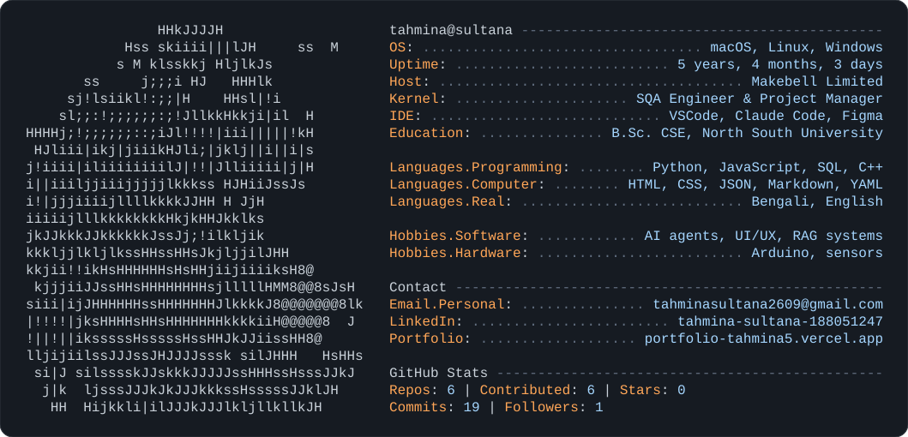

# Hi, I'm Tahmina 👋

**Product designer · UI/UX · Frontend · QA · AI-native**

I take features from raw research all the way to production-ready React and tests, mapping out the UI and tuning the AI behaviour along the way.

[**Portfolio**](https://portfolio-tahmina5.vercel.app) &nbsp;·&nbsp; [LinkedIn](https://bd.linkedin.com/in/tahmina-sultana-188051247) &nbsp;·&nbsp; [Lakeside 3D](https://lakeside-portfolio.vercel.app) &nbsp;·&nbsp; Dhaka, Bangladesh

<picture>
  <source media="(prefers-color-scheme: dark)" srcset="dark_mode.svg">
  <source media="(prefers-color-scheme: light)" srcset="light_mode.svg">
  
</picture>

## ✦ Featured

<table>
<tr>
<td width="50%" valign="top">

### [Lakeside](https://github.com/tahmina267/lakeside-portfolio)
**A portfolio you can walk into.** An interactive 3D mountain lake in three.js, with Gerstner waves, a forest in a shared wind field, a lake house with a physics-driven fire, and a day/night switch.

`three.js` `WebGL` `GLSL` · [Live →](https://lakeside-portfolio.vercel.app)

</td>
<td width="50%" valign="top">

### [PrintForge](https://github.com/tahmina267/printforge)
**A marketplace for 3D-printable models.** Browse designs in an interactive 3D viewer, follow creators, upload models, or turn a 2D picture into a 3D model with AI.

`Next.js` `TypeScript` `PostgreSQL` `three.js` `Hugging Face` · [Live →](https://printforge-brown.vercel.app)

### [Portfolio](https://portfolio-tahmina5.vercel.app)
**Nine case studies, from first sketch to shipped code,** with **Tara**, a small star mascot powered by a tool-calling AI that answers questions about my work.

`Next.js` `React` `AI agents` · [Visit →](https://portfolio-tahmina5.vercel.app)

</td>
</tr>
</table>

### More projects

| Project | What it is |
|---|---|
| [Bangla Programming Language](https://github.com/tahmina267/Bangla-Programming-Language) | A programming language in Bangla, so native speakers can learn coding concepts in their own language. Built with ANTLR and Java. |
| [Aethermind](https://github.com/tahmina267/Aethermind) | My Junior Design Course project. |
| [BayMax, medical chatbot](https://github.com/tahmina267/Medical_service_provider) | A Discord chatbot that takes symptoms and suggests next steps. A team project for Software Engineering. |

## ✦ How I work

**Frame** the one job worth doing → **sketch the behaviour**, including how the model acts when it's wrong → **design** flows, states and copy → **build** in React + TypeScript → **break it** with test matrices, VoiceOver and adversarial prompts → **measure and tune.**

## ✦ Toolkit

`Figma` `Framer` `Protopie` `React` `TypeScript` `Next.js` `Tailwind` `Storybook` `Three.js` `Playwright` `Python` `SQL` `Claude` `Cursor` `Notion` `Linear`

---

*"We are not just in the universe; we are the universe, dreaming in code and stardust."* · inspired by Carl Sagan

